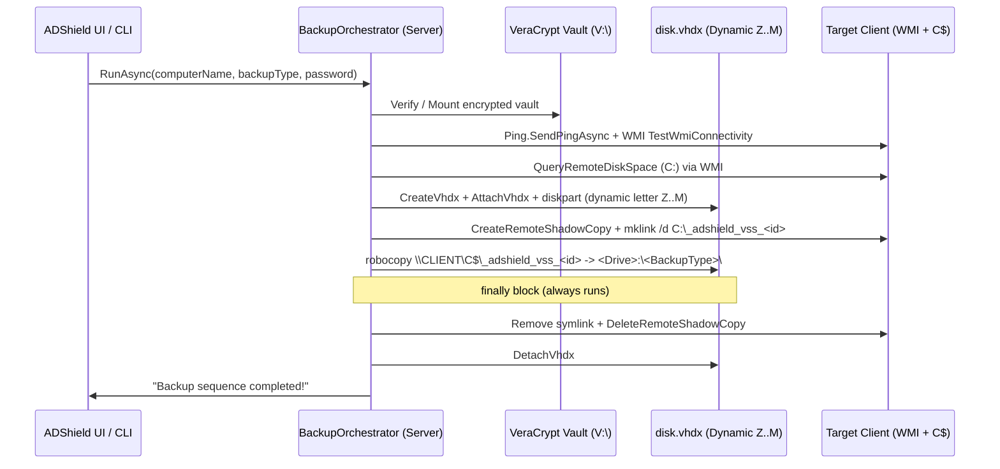

# AD Shield — 100% Agentless Network Backup Orchestrator

**ADShield** is a 100% agentless, server-only network backup orchestrator for Windows Active Directory environments. It compiles to a single native Windows executable (`ADShield.exe`, .NET 8) that runs exclusively on the backup server as a **WinForms management GUI** or **CLI automation tool**, coordinating encrypted VSS-based backups across domain computers with **zero software installed on target machines**.

> **Operational AD & GPO Guide:** See **[docs/AGENTLESS_ROADMAP.md](docs/AGENTLESS_ROADMAP.md)** (Implemented Phases 1–3) and **[docs/deployment-guide.md](docs/deployment-guide.md)** for Group Policy (GPO) firewall rules, Remote-to-Local (R2L) symlink evaluation policy, and least-privilege AD service account / gMSA setup.

---

## Key Features

- **100% Agentless & Server-Only** — Remote execution via WMI (`Win32_ShadowCopy`, `Win32_LogicalDisk`, `Win32_Process`) and SMB admin shares (`C$`); no client agents, services, or open HTTP ports
- **Server-Pull Architecture** — `robocopy.exe` runs locally on the backup server, pulling from `\\<Target>\C$\_adshield_vss_<id>` into a dynamically allocated VHDX drive letter (`Z`–`M`), eliminating Kerberos double-hop failures
- **AES-256 Encrypted Storage** — All backup data lives inside a VeraCrypt encrypted container (`.hc`) mounted on the backup server
- **Per-Machine VHDX Isolation** — Dynamically sized virtual disks (`disk.vhdx`) managed via native `VirtDisk.dll` and `diskpart.exe` with hardened `Administrators`/`SYSTEM` ACLs
- **LDAP AD Discovery** — Queries Active Directory directly via `System.DirectoryServices`; no AD PowerShell module needed
- **Automated Scheduling & Unattended Mounts** — Re-entrancy-guarded `SchedulerService` with bounded concurrency (`MaxConcurrentBackups`) and optional DPAPI-protected passphrase (`VaultSecretStore`) when `AllowUnattendedVaultMount` is enabled
- **Self-Healing Storage** — Automatically detects and reformats uninitialized/RAW VHDX partitions mid-backup
- **Dark Enterprise UI** — Modern WinForms dashboard with real-time terminal log and CSV log export

---

## How It Works



---

## Project Structure

```
Active-Directory-Backup-Utility-main/
├── ADShield/                           # .NET 8 WinForms + CLI application
│   ├── Core/
│   │   ├── AdDiscovery.cs              # LDAP AD computer discovery + ICMP ping
│   │   ├── AppConfig.cs                # JSON config & history persistence (%AppData%\ADShield)
│   │   ├── BackupOrchestrator.cs       # Agentless server-pull backup pipeline
│   │   ├── BackupValidationSuite.cs    # Pre-flight validation (temp I/O, diskpart, robocopy)
│   │   ├── ProcessRunner.cs            # Unified async child process wrapper
│   │   ├── SchedulerService.cs         # Re-entrancy-guarded cron-style backup scheduler
│   │   ├── SelfHealingDiagnostics.cs   # VHDX RAW-detection & auto-NTFS recovery diagnostic
│   │   ├── SmbShareManager.cs          # WMI Win32_Share query helper (ShareExists)
│   │   ├── VaultSecretStore.cs         # DPAPI (crypt32.dll) unattended passphrase store
│   │   ├── VeraCryptManager.cs         # Encrypted vault mount/dismount/create
│   │   ├── VhdxManager.cs              # Native VirtDisk.dll VHDX API
│   │   └── VssManager.cs               # WMI Win32_ShadowCopy, disk space & connectivity
│   ├── Forms/
│   │   ├── MainForm.cs                 # Application shell & 4-page nav
│   │   ├── MainForm.Events.cs          # Async UI handlers, concurrency & schedule execution
│   │   ├── BackupTriggerForm.cs        # Passphrase + backup type modal
│   │   └── Theme.cs                    # Design token system (colors, fonts)
│   ├── Models/
│   │   ├── AppSettings.cs              # Configuration model (MaxConcurrentBackups, AllowUnattendedVaultMount, etc.)
│   │   └── ComputerEntry.cs            # AD computer + backup status model
│   ├── Program.cs                      # Dual-mode entry point (GUI / CLI)
│   ├── app.manifest                    # UAC requireAdministrator & longPathAware
│   └── ADShield.csproj
├── ADShield.Tests/                     # xUnit test suite (.NET 8)
│   ├── LogicTests.cs                   # VHDX, Robocopy, UNC, VeraCrypt unit/integration tests
│   ├── SelfHealingTests.cs             # Admin-gated SelfHealingDiagnostics wrapper
│   ├── UnitTests.cs                    # AppSettings, SchedulerService, diskpart error & ProcessRunner tests
│   └── ADShield.Tests.csproj
├── docs/
│   ├── AGENTLESS_ROADMAP.md            # Implemented agentless architecture & AD/GPO guide
│   ├── CODE_MAP.md                     # Complete codebase & symbol map
│   ├── architecture.md                 # System diagrams, component maps & data flows
│   ├── code-reference.md               # Full class & method API reference
│   ├── deployment-guide.md             # Installation, GPO prerequisites & operations guide
│   └── winpe_recovery.md               # Bare-metal recovery procedure
└── README.md
```

---

## Quick Start

### Prerequisites

| Requirement | Details |
|-------------|---------|
| Windows Server 2019+ or Windows 10 21H2+ | Domain-joined |
| .NET 8 Desktop Runtime | [Download](https://dotnet.microsoft.com/download/dotnet/8) |
| VeraCrypt v1.26+ | [Download](https://www.veracrypt.fr) |
| AD Backup Service Account / Domain Admin | Required for remote WMI, VSS, and admin share (`C$`) access |
| GPO Configuration on Targets | WMI/DCOM/RPC + SMB (`445`) + ICMPv4 firewall rules, R2L symlink policy |
| **Run as Administrator** | Enforced by `app.manifest` (required for `diskpart` and `VirtDisk.dll`) |

### Build & Run

```powershell
# Clone the repository
git clone <repo-url>
cd Active-Directory-Backup-Utility-main

# Build
dotnet build ADShield\ADShield.csproj

# Publish
dotnet publish ADShield\ADShield.csproj -c Release -r win-x64 --self-contained false

# Run GUI as Administrator
.\ADShield\bin\Release\net8.0-windows\win-x64\publish\ADShield.exe
```

### First Backup

1. **Apply GPO prerequisites** to target OUs (see [docs/AGENTLESS_ROADMAP.md](docs/AGENTLESS_ROADMAP.md) Section 2)
2. **Run** `ADShield.exe` as Administrator on the backup server
3. **Configure** the VeraCrypt vault path and mount letter in **System Config**
4. **Sync** Active Directory to discover domain computers
5. **Click** a computer → **Backup** → Enter passphrase → **Full** or **Incremental**

For full instructions, see **[docs/deployment-guide.md](docs/deployment-guide.md)**.

---

## Documentation

| Document | Description |
|----------|-------------|
| [AGENTLESS_ROADMAP.md](docs/AGENTLESS_ROADMAP.md) | Implemented 100% agentless architecture, AD/GPO requirements, and security hardening |
| [CODE_MAP.md](docs/CODE_MAP.md) | Complete repository, component, and symbol map |
| [architecture.md](docs/architecture.md) | System diagrams, component maps, data flows, security model |
| [code-reference.md](docs/code-reference.md) | Complete class/method API reference |
| [deployment-guide.md](docs/deployment-guide.md) | Installation, GPO setup, configuration, operations, troubleshooting |
| [winpe_recovery.md](docs/winpe_recovery.md) | Bare-metal recovery with WinPE + VeraCrypt Portable |

---

## Testing

ADShield includes an xUnit test project (`ADShield.Tests`) and built-in runtime diagnostics:

| Suite / Tool | Location | Purpose |
|--------------|----------|---------|
| `UnitTests` | `ADShield.Tests/UnitTests.cs` | `AppSettings` defaults/JSON round-trip, `SchedulerService` lifecycle & cron parsing, `RunLocalDiskpart` non-zero exit handling, `ProcessRunner` streams/timeout/cancellation |
| `LogicTests` | `ADShield.Tests/LogicTests.cs` | VHDX create/mount/re-attach (admin), Robocopy quoting & copy, VeraCrypt mount & UNC resolution |
| `SelfHealingTests` | `ADShield.Tests/SelfHealingTests.cs` | Admin-gated wrapper for `SelfHealingDiagnostics` |
| `BackupValidationSuite` | `ADShield/Core/BackupValidationSuite.cs` | Pre-flight checks (temp I/O, `diskpart.exe`, `robocopy.exe`) via UI or `--test` |
| `SelfHealingDiagnostics` | `ADShield/Core/SelfHealingDiagnostics.cs` | Live RAW-VHDX detection & auto-NTFS recovery test via UI or `--diagnostics` |

```powershell
dotnet test ADShield.Tests\ADShield.Tests.csproj
```

---

## License

See [LICENSE](LICENSE) for details.
