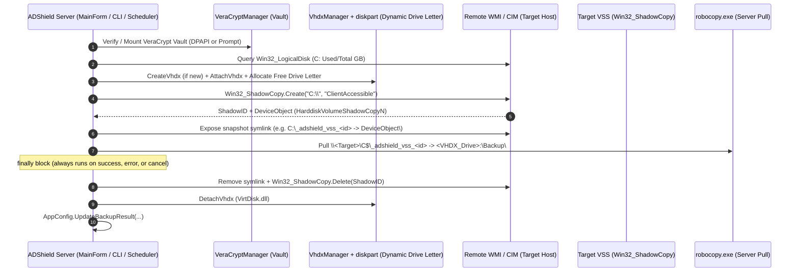

# ADShield — 100% Agentless Architecture Roadmap

> **Status:** Implemented (Phases 1–3)  
> **Goal:** Eliminate all client-side software, Windows services, and HTTP listeners (`AgentService`, `--service`, `--install`, `--uninstall`, port `9099`) so ADShield runs **100% from the central backup server**, leveraging Active Directory service accounts/gMSAs and Group Policy (GPO).

---

## 1. Target Agentless Architecture

### 1.1 Design Principles
- **Zero Client Footprint:** No `ADShield.exe`, no `ADShieldAgent` Windows service, no `agent_config.json`, and no open HTTP listener (`:9099`) on workstations or member servers.
- **Server-Initiated Control & Pull:** All orchestration, scheduling, encryption (VeraCrypt + VHDX), and data transfer are initiated and controlled exclusively by the backup server.
- **Native Windows Remote Management:** Uses built-in Windows protocols governed by Active Directory and GPOs:
  - **WMI / CIM (DCOM/RPC or WinRM)** for remote volume discovery, VSS shadow copy lifecycle (`Win32_ShadowCopy`), and optional remote command execution.
  - **SMB (`\\<Target>\C$` or scoped VSS access)** for server-pull data transfer via `robocopy.exe` into locally mounted encrypted VHDX containers.

### 1.2 Target End-to-End Pipeline

### 1.3 Components Eliminated vs. Retained

| Component | Current State | Target Agentless State |
|---|---|---|
| `ADShield/Core/AgentService.cs` | `ServiceBase` HTTP listener on `:9099` running `wbadmin.exe` | **Removed** |
| `Program.cs` `--service`, `--install`, `--uninstall` | Installs/runs `ADShieldAgent` via `sc.exe` & `netsh.exe` | **Removed** (server-only GUI & CLI) |
| `AppSettings.AgentPort`, `AgentApiKey` | HTTP auth settings | **Removed** |
| `SmbShareManager.CreateStagingShare` (`adshield_temp$`) | Server staging share with `Everyone` / `Authenticated Users` Full Control | **Removed** (server pulls directly into VHDX) |
| `VssManager.TestWmiConnectivity` | Currently probes HTTP `/status` on `:9099` | **Restored** to real WMI/CIM connectivity probe (`root\cimv2`) |
| `VhdxManager` (`virtdisk.dll`) + `VeraCryptManager` | Server-side encrypted storage | **Retained & expanded** (`AttachVhdx` / `DetachVhdx` used directly) |

---

## 2. Active Directory & Group Policy (GPO) Requirements

Because no client agent is installed, target machines must be prepared centrally through **Active Directory** and **Group Policy Objects (GPOs)** linked to the target computer OUs.

### 2.1 Dedicated Least-Privilege AD Backup Account (or gMSA)
- Create a dedicated AD service account (prefer a **Group Managed Service Account — gMSA**, e.g. `DOMAIN\gmsa-adshield$`, or a dedicated service account `DOMAIN\svc-adshield`) used to run ADShield on the backup server.
- **Target Machine Permissions (via GPO *Restricted Groups* or *User Rights Assignment*):**
  - Grant the backup service account membership in local **`Backup Operators`** (or local `Administrators` if WMI `Win32_ShadowCopy` + `C$` admin share access is required without UAC remote token filtering).
  - *Note on UAC Remote Restrictions:* If using a non-built-in local admin account on workgroup/domain hosts, configure `LocalAccountTokenFilterPolicy` only if required, or use a domain account in `Administrators` / `Backup Operators` with explicit WMI `root\cimv2` **Remote Enable** + **Execute Methods** permissions.
  - Grant **SeBackupPrivilege** (*Back up files and directories*) and **SeRestorePrivilege** (*Restore files and directories*) via `Computer Configuration → Policies → Windows Settings → Security Settings → Local Policies → User Rights Assignment`.
- **Backup Server Permissions:**
  - Dedicated service account owns the VeraCrypt container file and backup destination directory; interactive standard users have no access.

### 2.2 GPO Windows Defender Firewall Rules
Configure `Computer Configuration → Policies → Windows Settings → Security Settings → Windows Defender Firewall with Advanced Security → Inbound Rules` on target OUs, **scoped strictly to the Backup Server's IP address** (`Remote Address = <BackupServerIP>`):
1. **WMI / DCOM / RPC (Required for `System.Management` WMI & `Win32_ShadowCopy`):**
   - `Windows Management Instrumentation (DCOM-In)` — TCP `135`
   - `Windows Management Instrumentation (WMI-In)` — Dynamic RPC ports (`49152–65535` or RPC Endpoint Mapper)
2. **WinRM (If CIM/WinRM session transport is enabled as an alternative to DCOM):**
   - `Windows Remote Management (HTTP-In)` — TCP `5985` (or HTTPS `5986` with internal PKI cert)
3. **File and Printer Sharing (Required for `\\<Target>\C$` admin share pull):**
   - `File and Printer Sharing (SMB-In)` — TCP `445`
   - `File and Printer Sharing (Echo Request - ICMPv4-In)` — ICMPv4 (for `AdDiscovery` / pre-flight ping)

### 2.3 R2L Symlink Evaluation GPO (Replaces Runtime Registry Hacks)
When the backup server reads a target's VSS snapshot through a directory symlink exposed under `C$` (e.g., `\\<Target>\C$\_adshield_vss_<id>` → `\\?\GLOBALROOT\Device\HarddiskVolumeShadowCopyN\`), Windows blocks **Remote-to-Local (R2L)** symlink traversal by default.
- **Do NOT** mutate target registries at runtime via `StdRegProv` (the legacy `ServerPullTests` approach).
- Instead, enforce via GPO on the **Backup Server** (and targets if needed):
  - `Computer Configuration → Administrative Templates → System → Filesystem → Selectively allow the evaluation of a symbolic link`
  - Enable **Remote to local symbolic links** (`R2L = 1`) and **Local to local symbolic links** (`L2L = 1`).
  - Equivalent GPO registry policy key: `HKLM\SYSTEM\CurrentControlSet\Control\FileSystem\SymlinkRemoteToLocalEvaluation = 1`.

### 2.4 Volume Shadow Copy (`VSS`) & Remote Management Services Policy
Configure `Computer Configuration → Policies → Windows Settings → Security Settings → System Services` on target OUs:
- **Volume Shadow Copy (`VSS`)**: Startup Mode = **Manual** (or **Automatic**); ensure it is not Disabled so WMI `Win32_ShadowCopy.Create` can start it on demand.
- **Windows Management Instrumentation (`Winmgmt`)**: Startup Mode = **Automatic**.
- **Windows Remote Management (`WinRM`)** *(if CIM/WinRM is used)*: Startup Mode = **Automatic**, with `Allow remote server management through WinRM` GPO enabled and restricted to the backup server's IPv4/IPv6 filter.

---

## 3. Phased Implementation Plan

### Phase 1: Remove Client Agent, Legacy CLI Verbs, and Hardcoded Values
**Objective:** Strip out all agent-side code and environment-specific constants so the codebase is purely server-side and configurable.

1. **Delete Agent Service & HTTP API:**
   - Remove `ADShield/Core/AgentService.cs` (`AgentService`, `AgentConfig`, `AgentStatusResponse`, `BackupRequestPayload`).
   - Remove `System.ServiceProcess.ServiceController` dependency if no longer used.
2. **Clean `ADShield/Program.cs`:**
   - Remove `--service` branch (`ServiceBase.Run(new AgentService())`).
   - Remove `install` / `--install` / `-i` and `uninstall` / `--uninstall` / `-u` CLI verbs, `InstallAgentServiceAsync`, and `UninstallAgentServiceAsync`.
   - Remove hardcoded `@"C:\BackupUtility\bootstrap_error.log"`; log bootstrap errors to `Path.Combine(Environment.GetFolderPath(Environment.SpecialFolder.LocalApplicationData), "ADShield", "bootstrap_error.log")` (or `%TEMP%`).
3. **Clean `ADShield/Models/AppSettings.cs` & Settings UI:**
   - Remove `AgentPort` (`9099`) and `AgentApiKey`.
   - Add configurable fields:
     - `VhdMountDrivePool` or dynamic drive-letter discovery (eliminating hardcoded `"B"` in `BackupOrchestrator.cs`).
     - `MaxConcurrentBackups` (default `1`).
     - `StagingRootPath` (only if a temporary path is needed, eliminating hardcoded `E:\adshield_temp`).
4. **Eliminate Remaining Hardcoded Paths:**
   - `BackupOrchestrator.cs`: Remove `\\FILESVR\adshield_temp$\{computerName}`, `E:\adshield_temp`, and hardcoded `vhdxDriveLetter = "B"`.
   - `SelfHealingDiagnostics.cs`: Replace hardcoded `@"V:\backups"` and `"T"` with `AppConfig.ReadSettings().BackupRootPath` and a dynamically selected unused drive letter.

---

### Phase 2: Pure Server-Only Backup Engine & Storage Reliability
**Objective:** Replace HTTP agent calls in `BackupOrchestrator` with a native server-pull VSS engine, fix async/await anti-patterns, and harden VHDX management.

1. **Restore & Upgrade `VssManager.cs`:**
   - Restore `TestWmiConnectivity(string computerName, out string error)` to actually open a `ManagementScope($"\\\\{computerName}\\root\\cimv2")` connection and query `Win32_OperatingSystem` (instead of calling HTTP `/status`).
   - Add `DeleteRemoteShadowCopy(string computerName, string shadowId, ...)` and `GetShadowCopyDeviceObject(string computerName, string shadowId)` using remote `ManagementScope`.
   - Add `QueryRemoteDiskSpace(string computerName, string drive = "C:")` via `Win32_LogicalDisk` so VHDX auto-sizing (`UsedGb * 1.2`) works without an agent.
2. **Implement Agentless Backup Pipeline in `BackupOrchestrator.cs`:**
   - **File/Volume Backup (Primary):**
     1. Connect via WMI/CIM to target, query `C:` usage, and prepare/attach local VHDX.
     2. Call `VssManager.CreateRemoteShadowCopy(computerName, "C:\\")` to obtain `ShadowID` and `DeviceObject`.
     3. Expose the snapshot via a temporary symlink on the target (created and removed via WMI `Win32_Process.Create` or WinRM/CIM) and pull via `robocopy.exe` from `\\<Target>\C$\_adshield_vss_<id>` directly into the mounted VHDX drive using `/B` (backup mode, leveraging `SeBackupPrivilege`) or `/COPY:DAT`.
     4. Always remove the symlink and call `DeleteRemoteShadowCopy` in `finally`.
   - **Optional Bare-Metal / System-State Strategy:**
     - Document/support an optional WinRM/CIM-triggered `wbadmin start backup` (or `wbadmin start systemstatebackup`) for Domain Controllers or bare-metal WinPE recovery targets, writing to a per-machine scoped share without any persistent agent service.
3. **Eliminate Blocking `.Result` Calls:**
   - Remove all `.Result` calls (`GetAgentStatus`, `TriggerAgentBackup`, `CancelAgentBackup`, `TestWmiConnectivity`) and make all WMI/CIM/network operations genuinely `async` with `CancellationToken` support.
4. **Fix `diskpart` Exit-Code Checking & Integrate `VhdxManager`:**
   - Update `BackupOrchestrator.RunLocalDiskpart` to inspect `ProcessRunnerResult.ExitCode` and throw an exception when `ExitCode != 0` (currently it catches and logs `[WARN]` silently).
   - Use `VhdxManager.AttachVhdx` and `VhdxManager.DetachVhdx` (`virtdisk.dll` P/Invoke) for attach/detach, reserving `diskpart.exe` (or WMI `MSFT_Disk` / `MSFT_Partition`) only for initial GPT partitioning, NTFS formatting, and dynamic free drive-letter assignment.

---

### Phase 3: Scheduler Concurrency, Unattended Vault Auth & Automated Tests
**Objective:** Make scheduled backups genuinely unattended, concurrency-safe, and covered by automated tests.

1. **Fix `OnScheduledBackup` Concurrency & UI Coupling (`MainForm.Events.cs` & `SchedulerService.cs`):**
   - Decouple `TriggerBackup(string computerName)` (interactive UI with `BackupTriggerForm`) from `ExecuteBackupAsync(string computerName, string backupType, string veraCryptPassword, CancellationToken ct)`.
   - Guard concurrent execution with a `SemaphoreSlim(_settings.MaxConcurrentBackups)` and a `ConcurrentDictionary<string, bool>` active-job tracker so `OnScheduledBackup` never collides on VHDX drive letters, VeraCrypt mounts, or duplicate host jobs.
   - Fix `SchedulerService` timer re-entrancy so overlapping schedules cannot fire while a previous run is still queued.
2. **Unattended VeraCrypt Passphrase Handling:**
   - Support unattended scheduled runs without modal dialogs by storing an optional encrypted vault passphrase using **Windows DPAPI** (`ProtectedData.Protect(..., DataProtectionScope.LocalMachine)` or `CurrentUser` scoped to the service account) or **Windows Credential Manager**, with an explicit toggle in `AppSettings` (`AllowUnattendedVaultMount`).
   - If the vault is not already mounted and unattended credentials are not configured, fail fast with a clear scheduler log entry rather than blocking on a modal dialog.
3. **Automated Unit & Integration Tests (`ADShield.Tests`):**
   - Add automated unit tests covering:
     - `SchedulerService` cron parsing and concurrency/re-entrancy guards.
     - Dynamic drive-letter selection and `RunLocalDiskpart` non-zero exit-code failure handling.
     - `VssManager` WMI query/path formatting and `SmbShareManager` least-privilege DACL construction (if any shares remain).
     - `AppSettings` serialization/validation without `AgentPort`/`AgentApiKey`.

---

## 4. Security Hardening

| Area | Current Vulnerability / Debt | Hardened Target State |
|---|---|---|
| **NTFS ACLs (`BackupOrchestrator.cs`)** | Grants `Everyone:(OI)(CI)F`, `*S-1-5-11` (`Authenticated Users`):`(OI)(CI)F`, and `Domain Computers:(OI)(CI)F` on client backup folders and mounted VHDX root | Remove `Everyone`, `Authenticated Users`, and `Domain Computers` completely. Grant `FullControl` **only** to `BUILTIN\Administrators`, `NT AUTHORITY\SYSTEM`, and the dedicated `DOMAIN\svc-adshield` (or gMSA) backup account. |
| **SMB Share DACLs (`SmbShareManager.cs`)** | `BuildStagingShareSecurityDescriptor` grants `0x1F01FF` (Full Control) to `Everyone`, `Authenticated Users`, and `Domain Computers` | Eliminate `adshield_temp$` staging share entirely in server-pull mode. If a scoped share is ever used for bare-metal `wbadmin`, restrict its DACL strictly to `BUILTIN\Administrators` + the single target computer account (`DOMAIN\TargetPC$`). |
| **Client Attack Surface (`AgentService.cs`)** | Plaintext HTTP listener on `:9099` (`http://*:9099/`) with static default key `ADShieldDefaultApiKeySecret_ChangeMe` | **Eliminated.** Zero listening ports opened by ADShield on any client machine. |
| **Vault Passphrase** | Modal prompt only; no unattended secret protection | DPAPI-encrypted secret scoped to the backup server/service account (or pre-mounted vault), never stored in plaintext JSON or `.bat` files. |
| **Network Segmentation** | Unrestricted inbound rules in legacy scripts | GPO firewall rules for WMI/DCOM/RPC, WinRM, and SMB `445` scoped strictly to the Backup Server's static IP address. |
