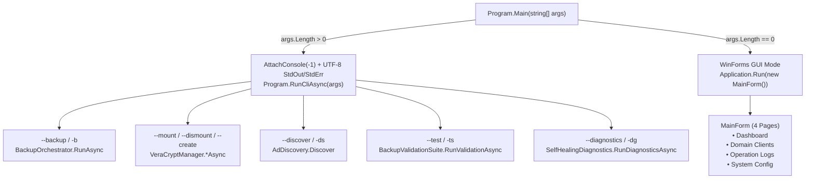
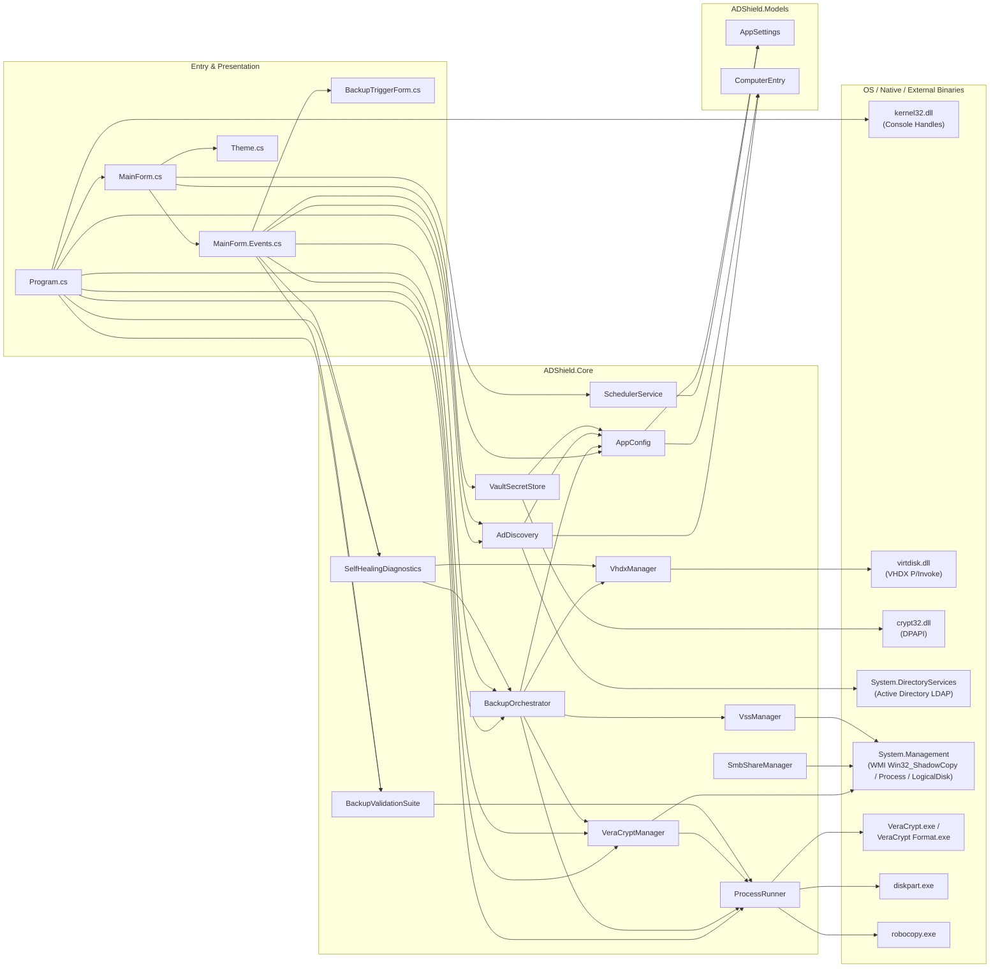
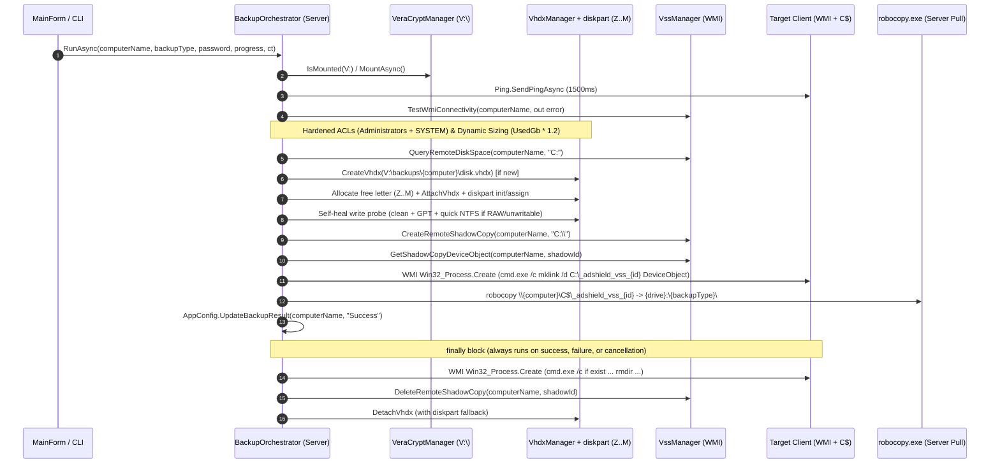

# ADShield — Project Code Map

> **Codebase Snapshot:** Maps the 100% agentless, server-only implementation across `ADShield` and `ADShield.Tests`.  
> **AD & GPO Operational Guide:** See [AGENTLESS_ROADMAP.md](AGENTLESS_ROADMAP.md) (Implemented Phases 1–3) for GPO firewall rules, R2L symlink policy, and AD service account setup.

---

## 1. Repository & Directory Map

```text
Active-Directory-Backup-Utility-main/
├── ADShield/                               # Primary .NET 8 Windows executable (GUI + CLI)
│   ├── ADShield.csproj                     # WinExe, net8.0-windows, AllowUnsafeBlocks, NuGet deps
│   ├── app.manifest                        # requireAdministrator UAC, longPathAware (PerMonitorV2 DPI in Program.cs)
│   ├── Program.cs                          # Dual-mode entry point: CLI verbs or WinForms GUI
│   ├── Core/
│   │   ├── AdDiscovery.cs                  # LDAP computer/group search + ICMP ping + IP resolution
│   │   ├── AppConfig.cs                    # %AppData%\ADShield\{config.json, history.json} persistence
│   │   ├── BackupOrchestrator.cs           # Agentless server-pull backup pipeline (WMI + VSS + VHDX)
│   │   ├── BackupValidationSuite.cs        # Pre-flight checks: temp I/O, diskpart.exe, robocopy.exe
│   │   ├── ProcessRunner.cs                # Unified async child process wrapper (stdout/stderr/timeout)
│   │   ├── SchedulerService.cs             # Re-entrancy-guarded System.Threading.Timer cron scheduler
│   │   ├── SelfHealingDiagnostics.cs       # Live RAW-VHDX detection & auto-NTFS recovery test
│   │   ├── SmbShareManager.cs              # Minimal WMI Win32_Share query helper (ShareExists)
│   │   ├── VaultSecretStore.cs             # DPAPI (crypt32.dll) unattended vault passphrase store
│   │   ├── VeraCryptManager.cs             # VeraCrypt CLI mount/dismount/create + UNC drive resolver
│   │   ├── VhdxManager.cs                  # Native P/Invoke wrapper over VirtDisk.dll
│   │   └── VssManager.cs                   # WMI Win32_ShadowCopy, Win32_LogicalDisk & Win32_OperatingSystem
│   ├── Forms/
│   │   ├── MainForm.cs                     # WinForms shell, sidebar nav, 4 pages, layout & builders
│   │   ├── MainForm.Events.cs              # Async UI handlers, SemaphoreSlim concurrency, DPAPI & CSV
│   │   ├── BackupTriggerForm.cs            # Modal dialog for BackupType + VeraCrypt passphrase
│   │   └── Theme.cs                        # Dark enterprise palette, typography, and control factories
│   └── Models/
│       ├── AppSettings.cs                  # Configuration POCO (Vault, Storage, AD, Cron, Concurrency)
│       └── ComputerEntry.cs                # Discovered host state + backup status + IP/ping metadata
├── ADShield.Tests/                         # xUnit test suite (.NET 8)
│   ├── ADShield.Tests.csproj               # References ADShield (via InternalsVisibleTo)
│   ├── LogicTests.cs                       # 6 unit/admin integration tests (VHDX, Robocopy, UNC, VeraCrypt)
│   ├── SelfHealingTests.cs                 # Wrapper around SelfHealingDiagnostics (admin-gated)
│   └── UnitTests.cs                        # AppSettings, SchedulerService, RunLocalDiskpart & ProcessRunner tests
└── docs/
    ├── AGENTLESS_ROADMAP.md                # Implemented 100% agentless architecture & AD/GPO guide
    ├── CODE_MAP.md                         # This comprehensive code & architecture map
    ├── architecture.md                     # System diagrams, component maps & server-pull pipeline
    ├── code-reference.md                   # Class & method API reference
    ├── deployment-guide.md                 # Setup, GPO prerequisites & operations guide
    └── winpe_recovery.md                   # Bare-metal WinPE + VeraCrypt + recovery guide
```

---

## 2. Dual-Mode Entry Point Map (`Program.cs`)

A single compiled binary (`ADShield.exe`) serves **two runtime roles** on the backup server depending on command-line arguments:



---

## 3. System Component & Dependency Graph



---

## 4. End-to-End Backup Pipeline Flow (`BackupOrchestrator`)

The backup pipeline runs **100% on the backup server**, pulling from the target machine's VSS snapshot symlink over `C$` into a dynamically allocated VHDX drive letter (`Z`–`M`):



---

## 5. File-by-File Module & Symbol Index

### `ADShield` Root & Entry

| File | Primary Types | Key Methods / Responsibilities | Persistence / External I/O |
|------|---------------|-------------------------------|----------------------------|
| `Program.cs` | `Program` (`internal static`) | `Main`, `RunCliAsync`, `PrintHelp` | Reads `AppConfig`, logs bootstrap errors to `%LocalAppData%\ADShield\bootstrap_error.log` |
| `ADShield.csproj` | MSBuild SDK Project | `net8.0-windows`, `WinExe`, `UseWindowsForms`, `AllowUnsafeBlocks` | NuGet: `System.DirectoryServices`, `System.Management`, `Newtonsoft.Json` |
| `app.manifest` | Win32 Manifest | Enforces `requireAdministrator` and `longPathAware` (`PerMonitorV2` DPI set in `Program.cs`) | Windows Loader / UAC |

### `ADShield.Core` (Business Logic & Infrastructure)

| File | Primary Types | Key Methods | Notes & Callers |
|------|---------------|-------------|-----------------|
| `BackupOrchestrator.cs` | `BackupOrchestrator` | `RunAsync`, `RunLocalDiskpart` (`internal`) | Agentless WMI/VSS + server-pull `robocopy.exe` pipeline. Called by `MainForm.Events.ExecuteBackupAsync` and `Program.RunCliAsync` (`--backup`). |
| `ProcessRunner.cs` | `ProcessRunner`, `ProcessRunnerResult` | `RunAsync(fileName, arguments, argumentList, timeout, progress, ct)` | Central async process execution utility; kills entire process tree (`Kill(entireProcessTree: true)`) on timeout/cancel. |
| `VeraCryptManager.cs` | `VeraCryptManager` | `MountAsync`, `DismountAsync`, `CreateContainerAsync`, `IsMounted`, `VeraCryptInstalled`, `ResolveUncPath` | Wraps `VeraCrypt.exe` and `VeraCrypt Format.exe` via `ProcessRunner`. Resolves mapped drives via `HKCU\Network` or WMI. |
| `VhdxManager.cs` | `VhdxManager` | `CreateVhdx`, `AttachVhdx`, `DetachVhdx`, `VhdxExists` | Direct P/Invoke to `virtdisk.dll` (`CreateVirtualDisk`, `OpenVirtualDisk`, `AttachVirtualDisk`, `DetachVirtualDisk`). |
| `SmbShareManager.cs` | `SmbShareManager` | `ShareExists` | Minimal WMI `Win32_Share` query helper. |
| `AdDiscovery.cs` | `AdDiscovery` | `Discover(searchOU, groupName, pingCheck, progress)` | Queries `LDAP://` via `DirectorySearcher` with recursive `LDAP_MATCHING_RULE_IN_CHAIN` (`1.2.840.113556.1.4.1941`) and 800ms ICMP ping. |
| `AppConfig.cs` | `AppConfig` | `ReadSettings`, `SaveSettings`, `ReadHistory`, `SaveHistory`, `MergeDiscovered`, `UpdateBackupResult` | Stores JSON in `%AppData%\ADShield\config.json` and `%AppData%\ADShield\history.json`. |
| `VaultSecretStore.cs` | `VaultSecretStore` | `SavePassphrase`, `LoadPassphrase`, `ClearPassphrase`, `HasPassphrase` | DPAPI (`crypt32.dll` `CryptProtectData`/`CryptUnprotectData`) storage in `%AppData%\ADShield\vault.dat`. |
| `SchedulerService.cs` | `SchedulerService : IDisposable` | `Start`, `Stop`, `Dispose`, `BackupTriggered`, `ParseCronHM` | Re-entrancy-guarded (`Interlocked.Exchange`) timer scheduler for nightly `"Incremental"` and weekly `"Full"` runs. |
| `VssManager.cs` | `VssManager`, `ShadowCopyInfo` | `CreateLocalShadowCopy`, `CreateRemoteShadowCopy`, `ListShadowCopies`, `DeleteShadowCopy`, `GetShadowCopyDeviceObject`, `DeleteRemoteShadowCopy`, `QueryRemoteDiskSpace`, `TestWmiConnectivity` | WMI `Win32_ShadowCopy`, `Win32_LogicalDisk`, and `Win32_OperatingSystem` wrapper. |
| `BackupValidationSuite.cs` | `BackupValidationSuite` | `RunValidationAsync` | Validates temp folder R/W, `diskpart.exe /s`, and `robocopy.exe /?`. Triggered via UI or `--test`. |
| `SelfHealingDiagnostics.cs` | `SelfHealingDiagnostics` | `RunDiagnosticsAsync` | Creates 10 MB RAW VHDX in `AppConfig.ReadSettings().BackupRootPath`, allocates free letter `Z`..`M`, verifies raw write fails, runs GPT/NTFS recovery, verifies write succeeds. |

### `ADShield.Forms` & `ADShield.Models`

| File | Primary Types | Key Responsibilities |
|------|---------------|----------------------|
| `Forms/MainForm.cs` | `MainForm : Form` (partial) | Builds sidebar navigation, top header bar, KPI cards, 4 views, and Settings controls (`MaxConcurrentBackups`, `AllowUnattendedVaultMount`, DPAPI passphrase Save/Clear). |
| `Forms/MainForm.Events.cs` | `MainForm` (partial) | Implements `SyncAd`, `RescanNetworkPings`, `TriggerBackup`, `ExecuteBackupAsync` (`SemaphoreSlim` + `ConcurrentDictionary`), `OnScheduledBackup`/`RunScheduledBackupAsync`, `CreateVeraCryptVolume`, settings handlers, and CSV log export. |
| `Forms/BackupTriggerForm.cs` | `BackupTriggerForm : Form` | Modal prompt collecting `SelectedBackupType` (`Incremental` or `Full`) and `VeraCryptPassword` (masked `TextBox`). |
| `Forms/Theme.cs` | `Theme` (`static`) | GitHub-dark-inspired color tokens, fonts, and styled WinForms control factories. |
| `Models/AppSettings.cs` | `AppSettings` | Settings model including `VeraCrypt*`, `BackupStorageRoot`, `VhdxSizeGb`, `SearchOU`, `AdGroup`, `ScheduleActive`, `NightlyCron`, `WeeklyCron`, `MaxConcurrentBackups`, `AllowUnattendedVaultMount`, and `BackupRootPath`. |
| `Models/ComputerEntry.cs` | `ComputerEntry` | Host record: `ComputerName`, `DnsHostName`, `OU`, `OperatingSystem`, `IsOnline`, `PingMs`, `IPAddress`, `LastBackupStatus`, `LastBackupTime`. |

---

## 6. State, Configuration & Log Locations

| File / Path | Host | Format | Created / Read By | Purpose |
|-------------|------|--------|-------------------|---------|
| `%AppData%\ADShield\config.json` | Backup Server | JSON (`AppSettings`) | `AppConfig` | Server settings, vault paths, cron, concurrency & unattended mount flags |
| `%AppData%\ADShield\history.json` | Backup Server | JSON (`List<ComputerEntry>`) | `AppConfig` | Discovered AD inventory & last backup status/timestamps |
| `%AppData%\ADShield\vault.dat` | Backup Server | DPAPI binary | `VaultSecretStore` | Optional encrypted VeraCrypt passphrase for unattended scheduled mounts |
| `%LocalAppData%\ADShield\bootstrap_error.log` | Backup Server | Plain text | `Program.Main` | Fallback CLI error log if console stream attachment fails |
| `%TEMP%\adshield_robocopy_<PC>.log` | Backup Server | Plain text | `BackupOrchestrator` | Per-machine local `robocopy` execution log |
| `V:\backups\<PC>\disk.vhdx` | Backup Server | GPT/NTFS VHDX | `BackupOrchestrator` / `VhdxManager` | Encrypted per-computer backup archive |

---

## 7. Test Suite Coverage Map (`ADShield.Tests`)

| Test File | Test Method | Privilege / Env Required | Target Under Test |
|-----------|-------------|--------------------------|-------------------|
| `UnitTests.cs` | `AppSettings_DefaultsAndJsonRoundTrip` | Standard User | `AppSettings` defaults & `Newtonsoft.Json` serialization |
| `UnitTests.cs` | `SchedulerService_InactiveStartAndIdempotentDispose` | Standard User | `SchedulerService.Start` / `Stop` / `Dispose` |
| `UnitTests.cs` | `SchedulerService_ParseCronHM_ValidAndFallback` | Standard User | `SchedulerService.ParseCronHM` |
| `UnitTests.cs` | `BackupOrchestrator_RunLocalDiskpart_ThrowsOnNonZeroExitCode` | Local Admin (auto-no-ops if non-admin) | `BackupOrchestrator.RunLocalDiskpart` error handling |
| `UnitTests.cs` | `ProcessRunner_CapturesExitCodeAndStreams` | Standard User | `ProcessRunner.RunAsync` stdout/stderr/exit code |
| `UnitTests.cs` | `ProcessRunner_RespectsCancellation` | Standard User | `ProcessRunner.RunAsync` `CancellationToken` |
| `UnitTests.cs` | `ProcessRunner_RespectsTimeout` | Standard User | `ProcessRunner.RunAsync` timeout & `TimeoutException` |
| `LogicTests.cs` | `TestVhdxCreateAndFormat` | Local Admin (auto-no-ops if non-admin) | `VhdxManager.CreateVhdx` + `BackupOrchestrator.RunLocalDiskpart` |
| `LogicTests.cs` | `TestVhdxExistingMount` | Local Admin (auto-no-ops if non-admin) | GPT Partition 2 re-attach persistence |
| `LogicTests.cs` | `TestRobocopyArgumentQuoting` | Standard User | `ProcessStartInfo.ArgumentList` & `ProcessRunner.RunAsync("robocopy.exe")` |
| `LogicTests.cs` | `TestVeraCryptMountDetection` | Standard User | `VeraCryptManager.IsMounted` & `ResolveUncPath` |
| `LogicTests.cs` | `TestUncPathResolutionEdgeCases` | Standard User | Null/empty/short-string handling in `ResolveUncPath` |
| `LogicTests.cs` | `TestRobocopyLocalCopy` | Standard User | End-to-end `ProcessRunner` + `robocopy.exe` directory tree copy |
| `SelfHealingTests.cs` | `TestSelfHealingDiagnostics` | Local Admin + `V:\` drive accessible | `SelfHealingDiagnostics.RunDiagnosticsAsync` |
