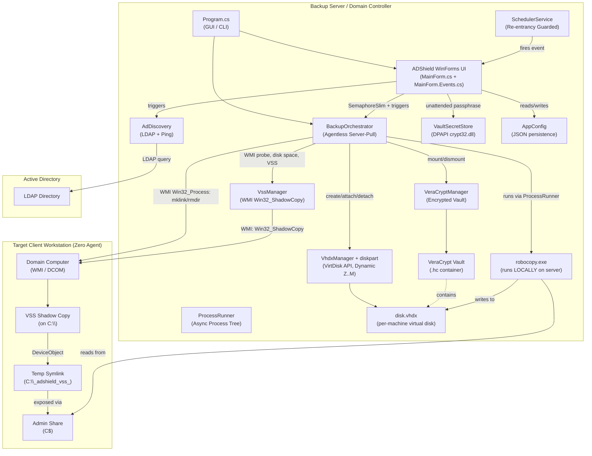
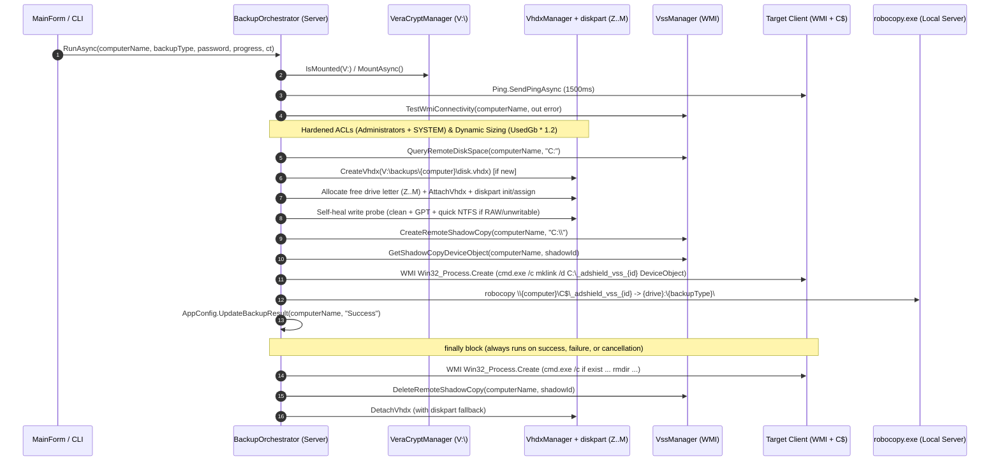
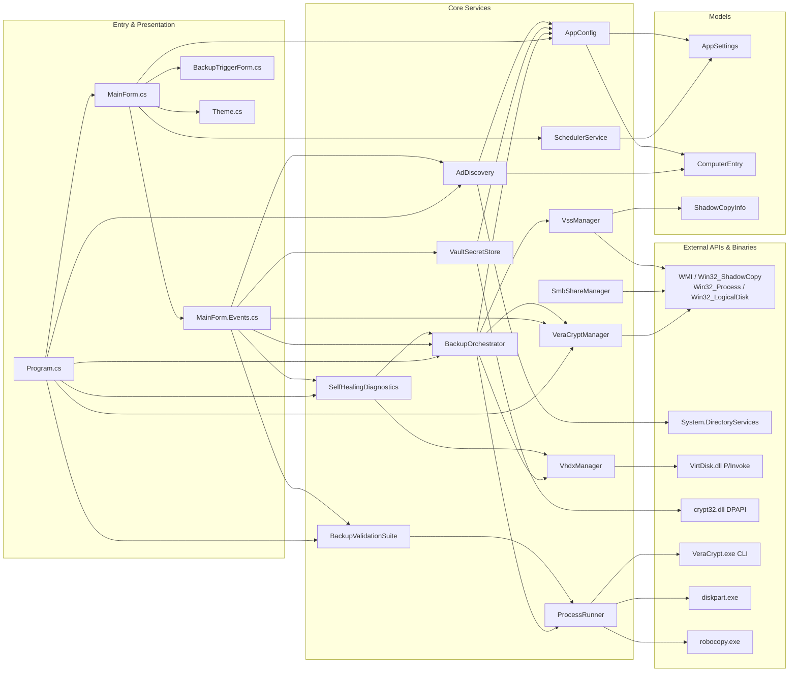
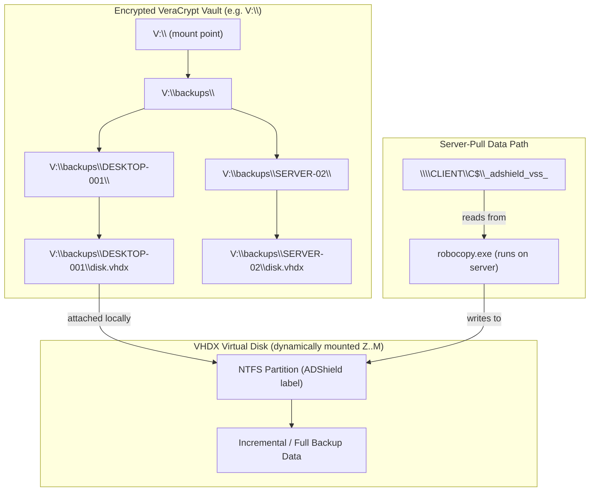
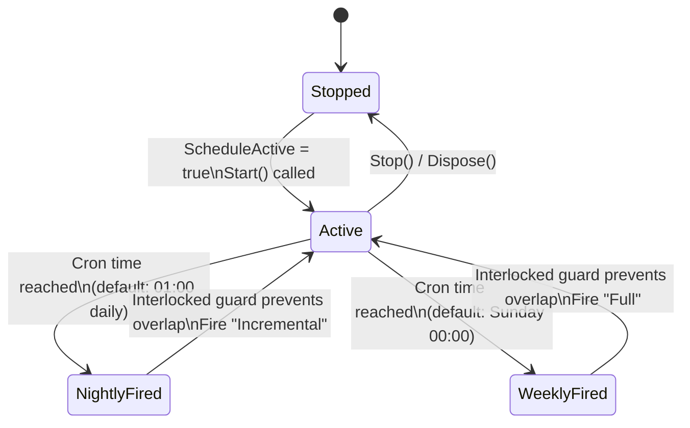

# ADShield Architecture Documentation

## Overview

ADShield is a **100% agentless, encrypted network backup orchestrator** for Windows Active Directory environments. It compiles to a single .NET 8 executable (`ADShield.exe`) that runs exclusively on the backup server as a Windows Forms GUI or CLI automation tool, coordinating VSS shadow copy creation via WMI and server-pull `robocopy.exe` transfers over SMB admin shares (`C$`) into per-machine VHDX disks inside an AES-256 VeraCrypt vault.

> **AD & GPO Operational Guide:** See **[AGENTLESS_ROADMAP.md](AGENTLESS_ROADMAP.md)** for the Group Policy (GPO) firewall rules, R2L symlink evaluation policy, and least-privilege AD service account / gMSA setup.

---

## System Architecture

### High-Level Component Diagram

---

### Backup Sequence Flow (100% Agentless Server-Pull)

---

### Component Dependency Map

---

## Data Flow: Backup Storage Architecture

---

## Technology Stack

| Layer | Technology | Purpose |
|-------|-----------|---------|
| **UI Framework** | Windows Forms (.NET 8) | Desktop GUI for backup management |
| **Language** | C# 12 | Core application logic and CLI |
| **AD Integration** | `System.DirectoryServices` | LDAP queries against Active Directory |
| **Remote Management** | WMI (`System.Management`) | Agentless `Win32_ShadowCopy`, `Win32_LogicalDisk`, `Win32_Process` |
| **Virtual Disk** | `VirtDisk.dll` (P/Invoke) | Native VHDX creation, attach, detach |
| **Disk Partitioning** | `diskpart.exe` (via `ProcessRunner`) | NTFS format, dynamic drive letter assignment (`Z`–`M`) |
| **Encryption** | `VeraCrypt.exe` (via `ProcessRunner`) | AES-256 container mount/dismount/create |
| **Secret Store** | `crypt32.dll` DPAPI (`VaultSecretStore`) | Optional encrypted unattended passphrase (`vault.dat`) |
| **File Copy** | `robocopy.exe` (local, `/B` mode) | Server-pull data transfer with backup privilege |
| **Persistence** | `Newtonsoft.Json` | Config and history serialization |
| **Scheduling** | `System.Threading.Timer` | Re-entrancy-guarded nightly/weekly triggers |

---

## Security Architecture

- **Zero client attack surface:** No agent, service, or HTTP listener runs on target machines.
- **Least-privilege GPO model:** Target OUs are governed by GPO firewall rules (scoped to the backup server IP), R2L symlink evaluation policy, and a dedicated AD backup service account / gMSA.
- **Hardened VHDX folder ACLs:** Per-machine backup folders grant `FullControl` only to `BUILTIN\Administrators` (`*S-1-5-32-544`) and `NT AUTHORITY\SYSTEM` (`*S-1-5-18`) — never `Everyone`, `Authenticated Users`, or `Domain Computers`.
- **VeraCrypt passphrase protection:** Held in memory only for interactive runs, or optionally stored via Windows DPAPI (`CryptProtectData`) in `%AppData%\ADShield\vault.dat` when `AllowUnattendedVaultMount` is explicitly enabled.
- **All backup data at rest** resides inside an **AES-256 encrypted** VeraCrypt container.

---

## Scheduler & Concurrency Architecture

In `MainForm.Events.cs`, scheduled and manual backups share `ExecuteBackupAsync`, gated by a `SemaphoreSlim` (`MaxConcurrentBackups`, minimum `1`) and a `ConcurrentDictionary<string, bool>` active-job tracker to prevent duplicate concurrent backups for the same host.

---

## Test & Diagnostic Suites

### `ADShield.Tests` (xUnit)

| Test Class | File | What It Validates |
|------------|------|-------------------|
| `UnitTests` | `ADShield.Tests/UnitTests.cs` | `AppSettings` defaults & JSON round-trip, `SchedulerService` inactive start & idempotent `Dispose`, `ParseCronHM`, `RunLocalDiskpart` non-zero exit code exception (admin-gated), `ProcessRunner` streams/cancellation/timeout |
| `LogicTests` | `ADShield.Tests/LogicTests.cs` | `TestVhdxCreateAndFormat` (admin), `TestVhdxExistingMount` (admin), `TestRobocopyArgumentQuoting`, `TestVeraCryptMountDetection`, `TestUncPathResolutionEdgeCases`, `TestRobocopyLocalCopy` |
| `SelfHealingTests` | `ADShield.Tests/SelfHealingTests.cs` | `TestSelfHealingDiagnostics` — admin-gated wrapper around `SelfHealingDiagnostics.RunDiagnosticsAsync` |

### Built-in Runtime Diagnostics (`ADShield/Core/`)

| Class | Trigger | What It Validates |
|-------|---------|-------------------|
| `BackupValidationSuite` | UI (`Run Tests` → Validation) or `--test` | Temp directory R/W, `diskpart.exe /s`, and `robocopy.exe /?` |
| `SelfHealingDiagnostics` | UI (`Run Tests` → Diagnostics) or `--diagnostics` | Creates a 10 MB RAW VHDX in `AppConfig.ReadSettings().BackupRootPath`, allocates a free drive letter (`Z`..`M`), verifies raw write fails, runs GPT/NTFS recovery, and verifies write succeeds |
